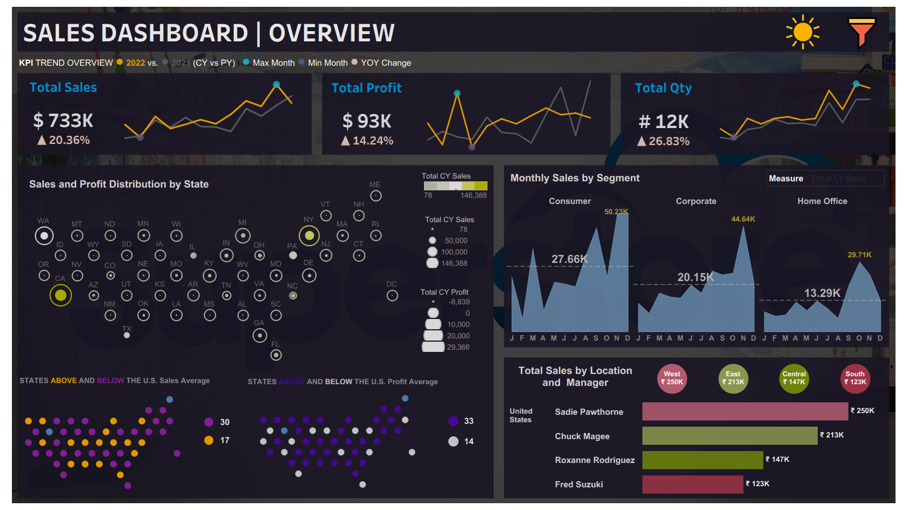

# 📊 Sales Performance Dashboard | Tableau

## 📌 Project Overview

This project focuses on analyzing sales performance, profitability, product performance, and regional trends using Tableau.

The dashboard was developed to transform raw sales data into interactive visualizations that make it easier to explore business performance and identify patterns across different dimensions, including time, region, state, customer segment, and shipping mode.

The project demonstrates the use of Tableau for business intelligence and data visualization, including KPI development, calculated fields, interactive filters, parameters, and geographic analysis.

## 🎯 Project Objectives

The primary objectives of this project are to:

- Monitor overall sales, profit, and quantity sold.
- Analyze monthly sales trends across customer segments.
- Compare sales performance across regions and states.
- Understand differences in profitability across geographic areas.
- Explore sales and profit patterns to identify high- and low-performing locations.
- Build an interactive dashboard that allows users to explore business metrics using filters and parameter controls.

## 🛠️ Tools and Technologies

- **Tableau Desktop:** Dashboard development, data visualization, calculated fields, parameters, and interactive analysis.
- **Microsoft Excel:** Source data containing sales transactions, regional manager information, and supporting geographic mapping data.

## 📂 Dataset Description

The project uses Superstore-style sales data covering orders from 2019 to 2022.

The main dataset contains transaction-level information about orders, customers, products, shipping, and financial performance.

### Key data fields

| Category | Fields |
|---|---|
| Order information | Order ID, Order Date, Ship Date, Ship Mode |
| Customer information | Customer ID, Customer Name, Segment |
| Geographic information | Country, City, State/Province, Postal Code, Region |
| Product information | Product ID, Category, Sub-Category, Product Name |
| Sales metrics | Sales, Quantity, Discount, Profit |

### Supporting datasets

**1. Regional manager data**

Contains regional information and corresponding regional managers, allowing sales performance to be explored alongside management assignments.

**2. State hex-map data**

Contains state names, abbreviations, and grid coordinates used to arrange states into a tile-based geographic visualization.

## 📈 Dashboard Components

### 1. Key Performance Indicators (KPIs)

The dashboard includes KPI views for:

- **Total Sales:** Overall sales value generated by the orders.
- **Total Profit:** Overall profit generated from sales.
- **Total Quantity:** Total quantity of products sold.

These metrics provide a high-level overview of business performance before exploring more detailed trends.

### 2. Monthly Sales Analysis

The *Monthly Sales by Segment* worksheet explores sales trends over time across customer segments.

This analysis helps users examine how sales performance changes month by month and compare the contribution of different customer segments.

### 3. Regional Sales Analysis

The *Region wise Sales* worksheet provides a comparison of sales performance across geographic regions.

This view helps identify differences in regional performance and supports further investigation into potential opportunities for improvement.

### 4. State-Level Sales and Profitability

The dashboard includes several state-level worksheets:

- Sales and Profit by State
- Average Profit by State
- Average Sales by State
- Supporting state-level metric views

These visualizations allow users to compare geographic performance and explore variations in sales and profitability across states.

### 5. Geographic Hex-Map Visualization

The project uses supporting state coordinates to arrange states into a hex-map layout.

This provides an alternative to a conventional geographic map and allows state-level metrics to be displayed in a consistent tile-based arrangement.

### 6. Sales by Location and Manager

The *Total Sales by Location and Manager* worksheet combines sales and geographic information with regional manager details.

This view supports exploration of sales performance across locations and management regions.

### 7. Interactive Controls

The workbook incorporates interactive controls, including filters and a measure-selection parameter.

These features allow users to change the displayed information and explore different aspects of sales performance without creating a separate dashboard for every analysis.

## 🔍 Business Questions Explored

The dashboard is designed to help investigate questions such as:

1. What are the overall sales, profit, and quantity figures?
2. How do sales trends change over time across customer segments?
3. Which regions generate comparatively higher sales?
4. How does profitability vary across states?
5. Which locations show differences between sales performance and profit generation?
6. How can sales performance be explored alongside regional manager information?
7. How can interactive filtering make sales analysis more flexible?

| File | Description |
|---|---|
| `Sales dashboard.twb` | Tableau workbook containing the worksheets, dashboards, calculations, and visualizations |
| `Sales Data.xls` | Main sales dataset and supporting sheets |
| `hexmap.xlsx` | State coordinates and abbreviations used for the hex-map visualization |
| `Sales Dashboard.png` | Screenshot preview of the dashboard |
| `README.md` | Project documentation |

## 🚀 How to View the Project

1. Clone or download this repository to your computer.
2. Ensure that Tableau Desktop is installed.
3. Open `Sales dashboard.twb` in Tableau Desktop.
4. If Tableau reports that a data source cannot be found, reconnect it to `Sales Data.xls` in the downloaded project folder.
5. Reconnect `hexmap.xlsx` if prompted.
6. Open the **Sales Dashboard** dashboard from the workbook tabs.
7. Explore the available visualizations, filters, and parameter controls.

## 💡 Key Learnings

Through this project, I gained hands-on practice with:

- Connecting Excel datasets to Tableau.
- Combining data from multiple tables using joins.
- Creating KPI visualizations for business metrics.
- Building calculated fields and reusable measures.
- Analyzing sales and profitability across geographic dimensions.
- Creating time-based and segment-based visualizations.
- Using parameters and filters to improve dashboard interactivity.
- Designing a dashboard that brings multiple business views together.
- Organizing a Tableau project for sharing and portfolio presentation.

## 📌 Conclusion

This project demonstrates how Tableau can be used to explore sales data through interactive dashboards and visual analysis. By bringing together financial KPIs, monthly trends, regional comparisons, and state-level visualizations, the dashboard provides multiple perspectives on business performance.

It served as a practical learning project for developing Tableau dashboarding skills and understanding how data visualization can support business analysis and decision-making.

## 👩‍💻 Project Information

**Project Type:** Data Visualization and Business Intelligence

**Primary Tool:** Tableau Desktop

**Data Source:** Excel

**Project Status:** Completed as a guided, hands-on learning project.
